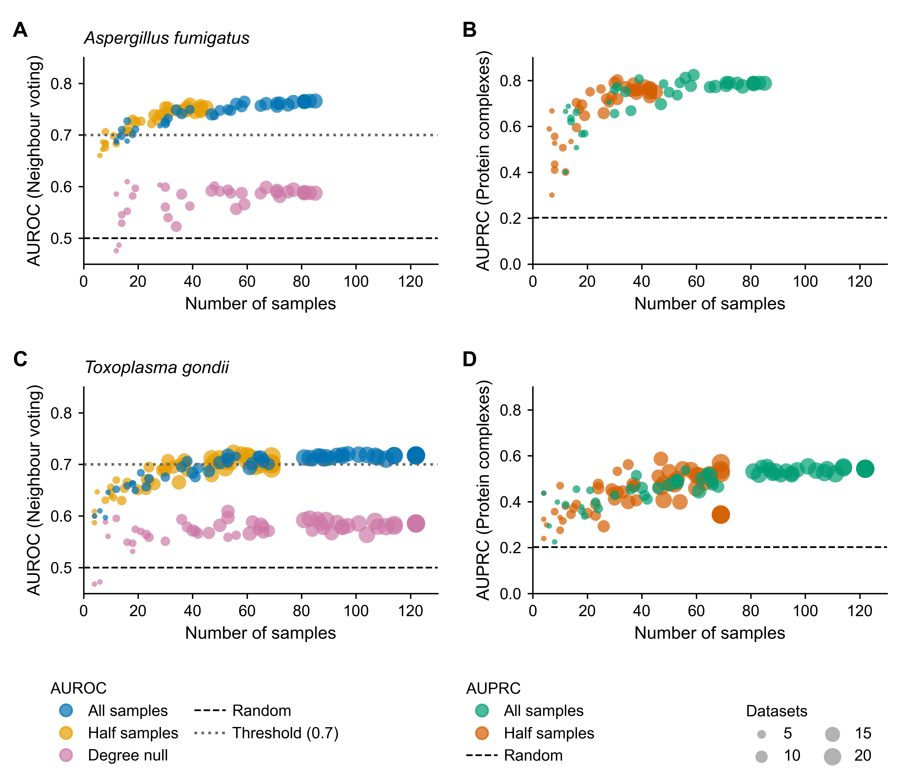

# Building the co-expression networks

Combined RNA-seq datasets were obtained for seven organisms (see [datasets](../Datasets)), and networks were built using [Build_networks.R](Build_networks.R).

Pearson's correlation coefficients (PCC) and mutual rank (MR) were calculated on filtered, batch-corrected log2(TPM + 1) values. MR was calculated as the geometric mean of the two ranks, √(rank_AB × rank_BA).

WGCNA v1.7.4 was run on filtered log2(TPM + 1) values that had been quantile normalised and then batch corrected. Signed networks were produced, using the lowest soft-thresholding power at which the scale-free topology fit index reached 0.85. If this threshold was not reached, the power recommended for that sample size in the [WGCNA guidance](https://edo98811.github.io/WGCNA_official_documentation/faq.html) was used.

Mutual rank networks for the seven organisms have been deposited in X.

To explore the utility of these networks (see [Utility](../Utility_of_networks)) at a gene-level, the top 10, 20 and 50 co-expressed partners were extracted from four networks: PCC, MR, WGCNA TOM and WGCNA TOM restricted to the gene’s module.

The co-expressed partners for these different methods have been deposited in X

# Evaluating the co-expression networks

Neighbour-voting AUROC and complex-recovery AUPRC were calculated for seven organisms with varying RNA-seq coverage using [Evaluating.R](Evaluating.R). Five networks were compared: PCC, ranked PCC, WGCNA TOM, binary WGCNA module co-membership and ranked MR.

- **Neighbour voting** requires propagated GO annotations, generated with [Propagate.py](Propagate.py).
- **Complex recovery** requires complex members. Candidates were identified from cellular component GO terms and genome annotation, and, where annotation was missing or unclear, by BLASTp against *S. cerevisiae* using [blast.py](blast.py). Positive and negative pairs for AUPRC were generated with [Complex_Pairs.py](Complex_Pairs.py).

Results are in each organism's folder, e.g. [AF](AF):

- Neighbour-voting results: [egad_results_asper.tsv](AF/egad_results_asper.tsv)
- Complex AUPRC results: [complex_results_asper.tsv](AF/complex_results_asper.tsv)
- WGCNA soft power: [asper_soft_power.tsv](AF/asper_soft_power.tsv)
- BLAST hits: [afum_complex_top_blast_hits.tsv](AF/afum_complex_top_blast_hits.tsv)
- Complex pairs: [asper_complex_pairs.tsv](AF/asper_complex_pairs.tsv)
- Propagated GO terms: [asper_computed_propagated.tsv](AF/asper_computed_propagated.tsv)

Overall, neighbour-voting AUROC was very similar across methods, but ranked MR outperformed the others in complex recovery, and WGCNA performed poorly.

| Organism | Strain | Samples | Ranked PCC GO AUROC | Ranked PCC AUPRC | Ranked MR GO AUROC | Ranked MR AUPRC | WGCNA GO AUROC | WGCNA AUPRC |
|---|---|---:|---:|---:|---:|---:|---:|---:|
| *Aspergillus nidulans* | FGSC A4 | 22 | 0.683 | 0.311 | 0.692 | 0.345 | 0.682 | 0.360 |
| *Candida auris* | B8441 | 42 | 0.703 | 0.577 | 0.708 | 0.656 | 0.690 | 0.340 |
| *Plasmodium berghei* | ANKA | 69 | 0.706 | 0.561 | 0.710 | 0.615 | 0.718 | 0.506 |
| *Aspergillus fumigatus* | Af293 | 85 | 0.753 | 0.778 | 0.766 | 0.794 | 0.728 | 0.379 |
| *Anopheles gambiae* | PEST | 101 | 0.749 | 0.665 | 0.761 | 0.773 | 0.764 | 0.611 |
| *Toxoplasma gondii* | ME49 | 122 | 0.708 | 0.513 | 0.717 | 0.543 | 0.716 | 0.365 |
| *Plasmodium falciparum* | 3D7 | 285 | 0.708 | 0.700 | 0.720 | 0.736 | 0.719 | 0.651 |
| **Mean (range)** | | | 0.716 (0.683–0.753) | 0.586 (0.311–0.778) | 0.725 (0.692–0.766) | 0.637 (0.345–0.794) | 0.717 (0.682–0.764) | 0.459 (0.340–0.651) |

# Subsampling

To determine the minimum sample size, ranked MR networks were built from five random combinations of datasets at every second dataset count (2, 4, 6, …), and rerun with half the samples from each dataset.

- Draws were generated with [sample_cutoffs.py](sample_cutoffs.py) (full) and [sample_cutoffs_half.py](sample_cutoffs_half.py) (half).
- Networks were built and evaluated with [subsample.R](subsample.R).
- Results were summarised with [explore_subsample.py](explore_subsample.py) ([results](Subsampling/cutoff_bins_all_genomes.tsv)) and plotted with [plot_subsample.py](plot_subsample.py).

Sample number was the main driver of performance: at the same sample size, networks with more datasets did not generally perform better. *A. fumigatus* reached good performance with the fewest samples, and *T. gondii* needed the most.

Using the mean dataset count at the lenient (*A. fumigatus*) and strict (*T. gondii*) sample-size thresholds gives the organisms in VEuPathDB with sufficient RNA-seq data: [lenient](Subsampling/lenient_rna_organism.tsv) and [strict](Subsampling/strict_rna_organism.tsv).
