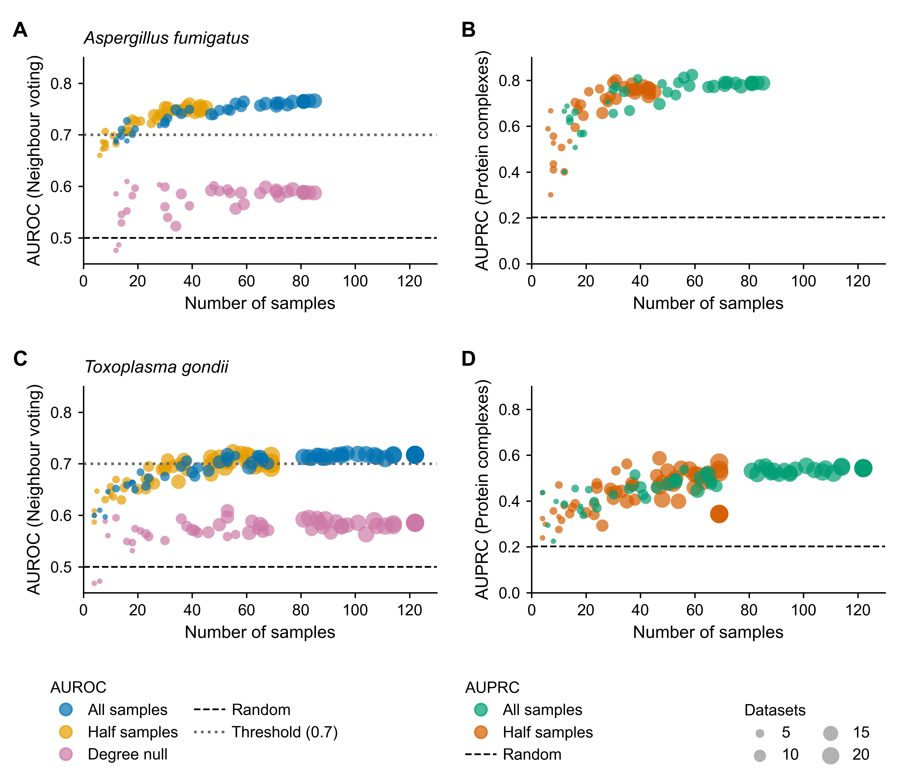
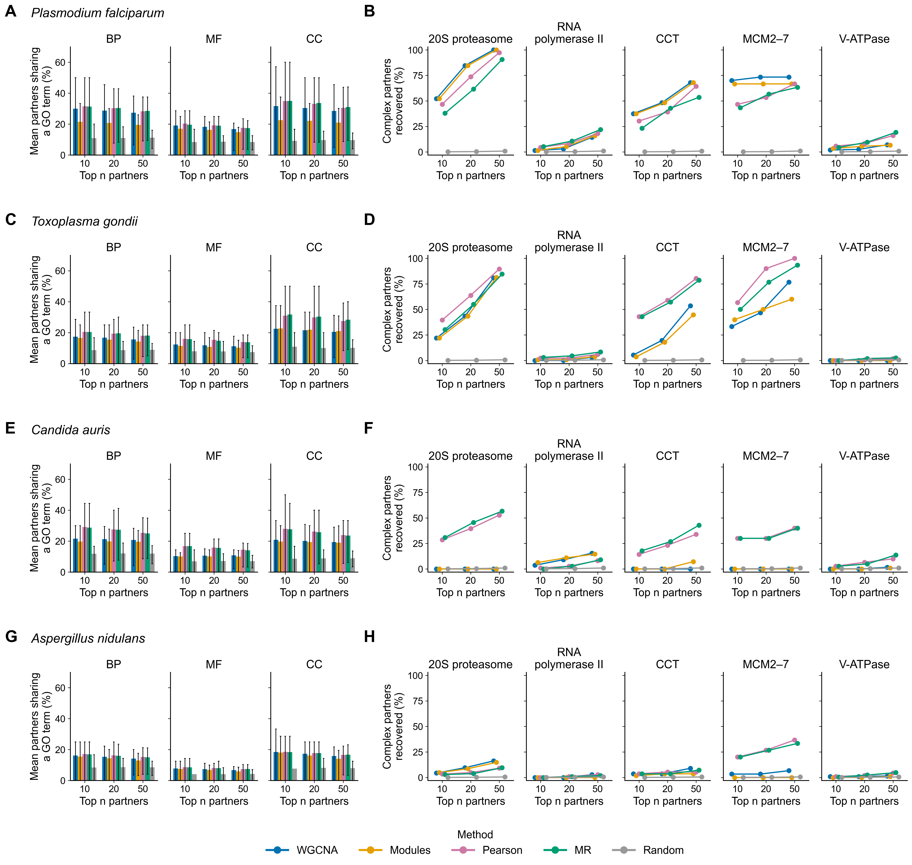

# VEuPathDB_coexpression

This repository holds the scripts and results for the paper "Optimising construction of co-expression networks for eukaryotic pathogens and vectors to infer gene function".

Three co-expression network construction methods (Pearson correlation coefficient (PCC), mutual rank (MR) and weighted gene co-expression network analysis (WGCNA)) were compared across seven genomes (*Aspergillus fumigatus*, *Aspergillus nidulans*, *Anopheles gambiae*, *Candida auris*, *Plasmodium berghei*, *Plasmodium falciparum* and *Toxoplasma gondii*). Networks were evaluated by GO term prediction and protein complex recovery, with the aim of assessing the utility of co-expression networks for VEuPathDB.

## Datasets
The [datasets](Datasets/README.md) used in this analysis were TSV files containing every RNA-seq study available on VEuPathDB release 71 for the seven genomes.

## Preprocessing
Optimal preprocessing was assessed in four genomes (*A. fumigatus*, *A. gambiae*, *P. falciparum* and *T. gondii*) using different combinations of quantile normalisation and batch correction, as detailed in [Preprocessing_comparison](Preprocessing_comparison/README.md). Both PCC and WGCNA benefited from batch correction, whereas only WGCNA benefited from quantile normalisation.

## Evaluation
The three methods were assessed across the seven genomes using neighbour-voting AUROC and complex-recovery AUPRC, as detailed in [Evaluating_coexpression_networks](Evaluating_coexpression_networks/README.md). PCC and MR were superior for complex recovery. Subsampling was also used to estimate the sample size needed for good-quality networks.

## Utility
The practical use of these networks for a VEuPathDB user was explored using GO term matching and complex recovery among each gene's top co-expression partners, as detailed in [Utility_of_networks](Utility_of_networks/README.md). In general, PCC and MR performed best.

The poor recovery of RNA polymerase II and the V-ATPase was explored further.

Finally, a case study simulated a research question: the MR network of PfABP pointed to its experimentally validated role alongside ATP4.
