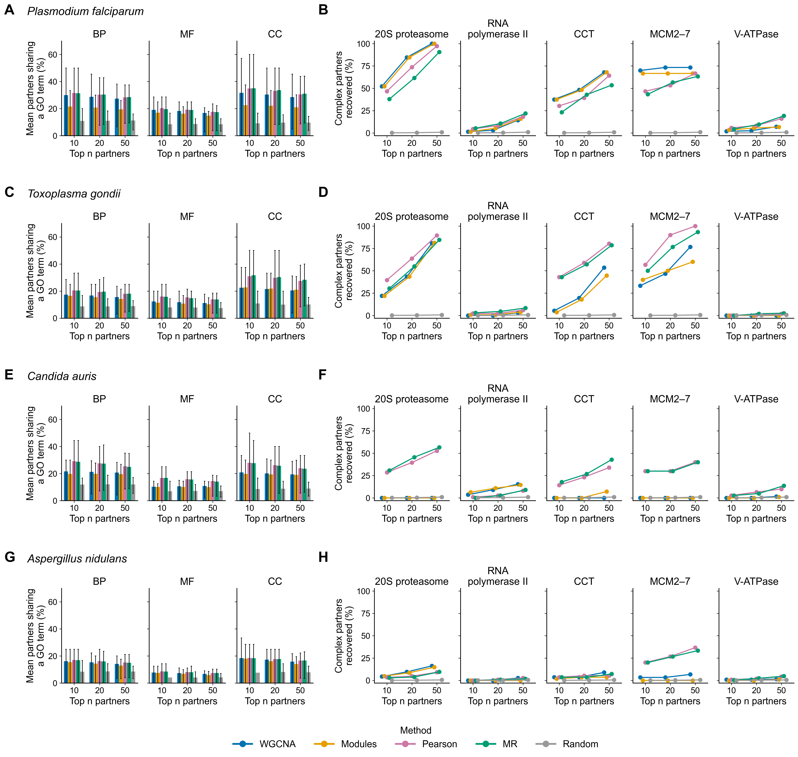

# Exploring the utility of co-expression networks

The top 10, 20 and 50 co-expressed partners of each gene were extracted from four networks: PCC, MR, WGCNA TOM and WGCNA TOM restricted to the gene's module. Networks were built with [Build_network.R](../Evaluating_coexpress_networks/Build_network.R) and are deposited at X.

## GO matching

For every gene with at least one GO annotation in the ontology of interest, the percentage of partners sharing at least one propagated GO term (computed and curated combined; GO terms with ≤300 genes) was calculated for each cutoff and method using [go_matching.py](go_matching.py). For WGCNA restricted to modules, genes in the grey (unassigned) module were scored as a negative match.

At all sample sizes, GO matching remained above random, with a general trend of MR and PCC performing better than WGCNA TOM and WGCNA modules.

## Complex recovery

For each subunit of the five complexes, the percentage of the other subunits in that complex found within its top 10, 20 and 50 co-expressed genes was calculated and averaged across subunits to give a score for each complex using [complex_recovery.py](complex_recovery.py).

PCC and MR generally performed better than WGCNA. Recovery declined as sample size decreased, and RNA polymerase II and the V-ATPase were poorly recovered in all genomes.

Figure 2: Functional relationships between co-expressed partners 

The top 10, 20 and 50 co-expressed partners of each gene were extracted from four networks (WGCNA TOM, blue; WGCNA TOM restricted to modules, orange; PCC, pink; MR, green) and compared with a random baseline (grey). The results are shown for four genomes: P. falciparum, T. gondii, C. auris and A. nidulans. (A, C, E, G) Mean percentage of co-expressed partners sharing at least one GO term (≤300 genes) with the gene of interest, for every gene annotated in that ontology; error bars show the interquartile range. (B, D, F, H) Mean percentage of each complex recovered within a subunit’s top partners, averaged across subunits, for the 20S proteasome, RNA polymerase II, CCT, MCM2-7 and the V-ATPase. 

## Why were some complexes poorly recovered?

- **Expression patterns:** mean-centred, batch-corrected log2(TPM + 1) expression was plotted for each complex member using [Complex expression](complex_expression.py). Clear bands of expression were seen for the proteasome, CCT and MCM2–7. RNA polymerase II also showed bands, but these mirrored CCT, while the V-ATPase showed no clear bands.
- **Expression variability:** the standard deviation of expression was plotted for each complex using [standard deviation](std.py). RNA polymerase II and the V-ATPase consistently had low SD, although the *A. fumigatus* proteasome had the lowest SD despite high recovery.
- **Subunit × subunit MR ranks:** a matrix of each subunit's MR rank for every other member of its complex was produced using [MR matrix](mr_rank_matrix.py). In RNA polymerase II, RPB1 and RPB2 consistently ranked each other highly, but no other clear pattern was seen for RNA polymerase II or the V-ATPase.

Figure 3: Recovery of complexes 

(A) Mean-centred, batch-corrected log2(TPM + 1) expression of members of five complexes (20S proteasome, RNA polymerase II, CCT, MCM2-7 and V-ATPase) across the datasets used to construct the P. falciparum co-expression network. Datasets are ordered with intraerythrocytic developmental cycle (IDC) time-course datasets first. (B-D) Standard deviation of expression across all samples for each complex in P. falciparum (B), T. gondii (C) and A. fumigatus (D), with the standard deviation of expression for all genes given for comparison. (E-G) Subunit × subunit matrices for P. falciparum (E), T. gondii (F) and A. fumigatus (G), showing the MR rank of each complex member (columns) within each subunit’s co-expression list (rows), binned into 1-10, 11-20, 21-50, 51-100, 101-200 and >200. Subunits are named using S. cerevisiae nomenclature. 
